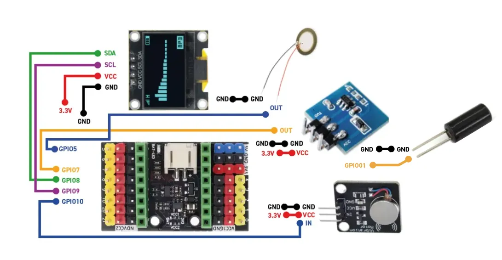

# 🤖 Desk Buddy — UWI Robotics Club 2026

An interactive OLED-based desk companion built using the **Seeed Studio XIAO ESP32-C3**. The Desk Buddy features an internet-connected weather station, a playable Dino Run game, and an expressive animated face with multiple moods.

This repository contains two versions of the project, supporting different OLED display controllers.

---

## 📁 Repository Structure

```text
Desk_Buddy_Project_Examples/
│
├── README.md
│
├── 01_Weather_Station.ino
├── 02_Dino_Run.ino
├── 03_Expressive_Desk_Buddy.ino
│
└── Only_1.3INCH_Display/
    ├── 01_Weather_Station.ino
    ├── 02_Dino_Run.ino
    └── 03_Expressive_Desk_Buddy.ino
```

**Display versions:**

- **Main folder:** SSD1306 OLED display.
- **Only_1.3INCH_Display:** 1.3-inch SH110X OLED display.

Both versions use the same microcontroller, I²C connections, and capacitive touch sensor pin assignment.

---

## 🔌 Hardware Requirements

| Component | Description | Quantity |
|---|---|---:|
| Microcontroller | Seeed Studio XIAO ESP32-C3 | 1 |
| OLED Display | 128 × 64 SSD1306 or 1.3-inch SH110X | 1 |
| Touch Sensor | TTP223B Capacitive Touch Sensor | 1 |
| Jumper Wires | Male-to-female / male-to-male as required | As needed |
| USB Cable | USB data cable for programming and power | 1 |

### Pin Connections

The following pin assignments apply to **both display versions**.

| Component | Pin | XIAO ESP32-C3 |
|---|---|---|
| OLED | SDA | GPIO 8 (D8) |
| OLED | SCL | GPIO 9 (D9) |
| OLED | VCC | 3.3V |
| OLED | GND | GND |
| TTP223B | OUT / SIG | **GPIO 7 (D7)** |
| TTP223B | VCC | 3.3V |
| TTP223B | GND | GND |

### 🔌 Wiring Diagram




> **Important:** The capacitive touch sensor output is connected to **GPIO 7 (D7) in BOTH codebases**. There is no difference in touch sensor wiring between the SSD1306 and SH110X versions.

---

## 📺 Display Libraries

### SSD1306 Version

Install the following libraries through the Arduino IDE Library Manager:

- Adafruit SSD1306
- Adafruit GFX Library
- Adafruit BusIO

### 1.3-inch SH110X Version

Install:

- Adafruit SH110X
- Adafruit GFX Library
- Adafruit BusIO

Both display versions use the I²C communication interface and typically operate at address `0x3C`.

---

# 🌤️ Project 1: Internet Weather Station

An internet-connected weather station that retrieves weather information based on the user's approximate location.

### Features

- Wi-Fi network scanning and connection status.
- Automatic location detection using public IP geolocation.
- Live weather information using the Open-Meteo API.
- Current temperature.
- Feels-like temperature.
- Humidity.
- Wind speed.
- Daily maximum and minimum temperatures.
- Local date and time.
- Weather condition graphics and icons.
- Multiple information screens.
- Touch-based navigation.
- Wi-Fi reconnection handling.

### APIs Used

| Service | Purpose |
|---|---|
| IP-API | Approximate location detection |
| Open-Meteo | Weather information |

The APIs used by this project do not require an API key for the requests implemented in the sketch.

### Configuration

Before uploading, enter your Wi-Fi credentials in the sketch:

```cpp
const char* WIFI_SSID = "YOUR_WIFI_NAME";
const char* WIFI_PASSWORD = "YOUR_WIFI_PASSWORD";
```

**Note:** Do not publish your actual Wi-Fi credentials in a public repository.

---

# 🦖 Project 2: Dino Run

A miniature recreation of the Google Chrome offline dinosaur game, displayed on the OLED screen.

### Features

- Animated dinosaur character.
- Jump mechanics with gravity and velocity.
- Random cactus obstacles.
- Flying bird obstacles.
- Increasing game difficulty.
- Score tracking.
- High-score tracking during the current powered session.
- Day and night visual transitions.
- Cloud animations.
- Collision detection.
- Game-over screen.
- Touch-based jumping and restarting.

### Gameplay

1. Touch the TTP223B sensor to start the game.
2. Touch again to make the dinosaur jump.
3. Avoid the cacti and flying birds.
4. Survive as long as possible to increase your score.
5. After a collision, touch the sensor to restart.

The game uses software-based animation and physics calculations to create a responsive experience on the 128 × 64 OLED display.

---

# 😊 Project 3: Expressive Desk Buddy

An animated digital companion that displays different facial expressions and moods.

### Features

The Desk Buddy supports **20 different expressions**:

| # | Expression | # | Expression |
|---:|---|---:|---|
| 1 | Neutral | 11 | Dizzy |
| 2 | Happy | 12 | Cool |
| 3 | Sad | 13 | Excited |
| 4 | Angry | 14 | Mischievous |
| 5 | Sleepy | 15 | Worried |
| 6 | Surprised | 16 | Bored |
| 7 | Love | 17 | Shocked |
| 8 | Wink | 18 | Laughing |
| 9 | Confused | 19 | Suspicious |
| 10 | Crying | 20 | Sleeping |

### Animation Features

- Animated blinking.
- Eye movement.
- Different eye shapes and expressions.
- Animated mouth expressions.
- Tears and hearts.
- Stars and other visual effects.
- Automatic sleeping after inactivity.
- Wake-up animation.
- Touch-based expression cycling.

### Interaction

The TTP223B capacitive touch sensor provides the main interaction mechanism.

- Touch the sensor to cycle through expressions.
- The Desk Buddy automatically enters its sleeping animation after approximately 20 seconds of inactivity.
- Touching the sensor wakes the Desk Buddy.
- A wake-up animation plays before returning to normal expressions.

**Note:** The sleeping feature is an animated software state. The ESP32-C3 remains powered and does not enter deep sleep.

---

## ⚙️ Software Requirements

| Software / Library | Purpose |
|---|---|
| Arduino IDE | Programming environment |
| ESP32 Board Package | ESP32-C3 compilation and uploading |
| Adafruit GFX | Graphics rendering |
| Adafruit SSD1306 | SSD1306 display support |
| Adafruit SH110X | SH110X display support |
| Adafruit BusIO | Display communication support |

Additional standard ESP32 libraries are used for Wi-Fi connectivity, HTTP requests, and time synchronisation in the Weather Station project.

---

## 🚀 Getting Started

### 1. Install Arduino IDE

Download and install the Arduino IDE.

### 2. Install ESP32 Board Support

In Arduino IDE:

1. Open **File → Preferences**.
2. Add the Espressif ESP32 board package URL if it is not already configured.
3. Open **Tools → Board → Boards Manager**.
4. Search for `esp32`.
5. Install the Espressif Systems ESP32 package.
6. Select the Seeed Studio XIAO ESP32C3 board.

### 3. Install the Required Libraries

Open **Sketch → Include Library → Manage Libraries** and install the libraries required for your selected display version.

### 4. Select Your Display Version

- For the SSD1306 display, use the sketches in the main repository folder.
- For the 1.3-inch SH110X display, use the corresponding sketches in `Only_1.3INCH_Display`.

### 5. Check Your Connections

Before uploading, verify:

- OLED SDA → GPIO 8 (D8).
- OLED SCL → GPIO 9 (D9).
- TTP223B OUT → GPIO 7 (D7).
- All VCC and GND connections are correct.

### 6. Upload the Sketch

Connect the XIAO ESP32-C3 to your computer using USB, select the correct COM port, and upload your chosen sketch.

---

## 📌 Important Notes

- Both display versions use the same GPIO assignments for the OLED and touch sensor.
- The touch sensor output is **GPIO 7 (D7)** in both codebases.
- The SSD1306 and SH110X versions require their respective display libraries.
- The Weather Station requires an active Wi-Fi connection.
- Keep Wi-Fi credentials private when sharing the project.
- The Desk Buddy's sleeping animation does not switch off the microcontroller.

---

## 🎯 Project Objective

The Desk Buddy project demonstrates how microcontrollers, OLED displays, capacitive touch sensing, internet connectivity, and software-based animations can be combined to create an interactive embedded system.

It introduces practical concepts in:

- Embedded systems programming.
- GPIO configuration and digital input.
- I²C communication.
- OLED graphics and animation.
- Wi-Fi connectivity.
- API integration.
- Basic game development.
- Event-driven programming.

**Developed for the UWI Robotics Club — 2026.**